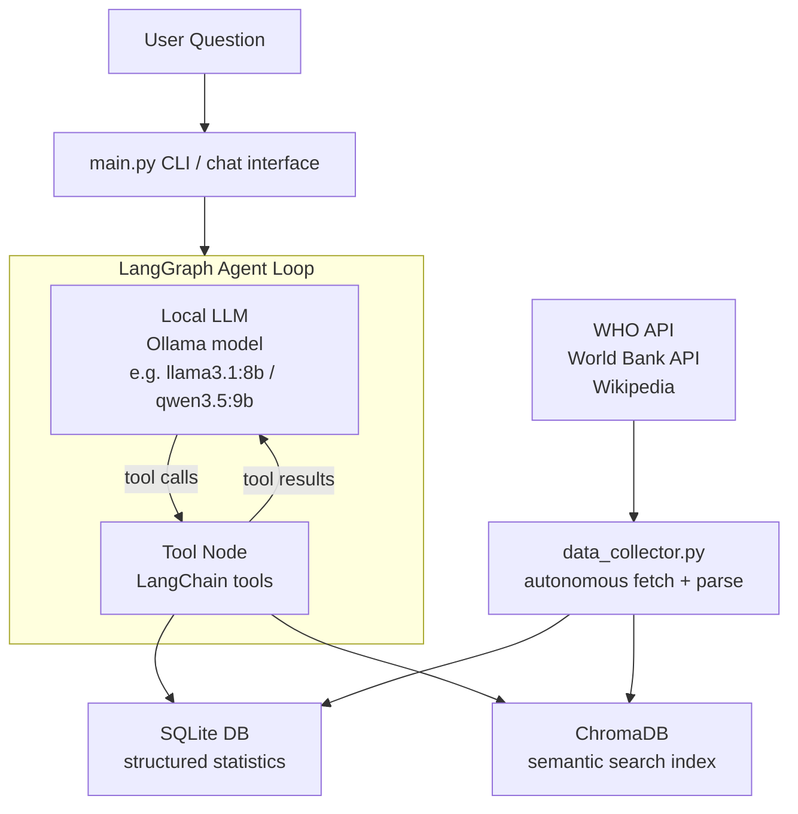

# Cancer AI Agent (Local version - Ollama)

A fully autonomous agentic AI system that collects cancer statistics from the web,
stores them in a local database, and lets you query them in natural language.
Runs entirely on your GPU (no cloud API keys required).

## Requirements

- Linux with NVIDIA GPU (RAM requirement depends on the model used)
- Python 3.12+
- [Ollama](https://ollama.com) installed and running

## Setup

```bash
# 1. Install Ollama
curl -fsSL https://ollama.com/install.sh | sh
ollama serve &

# 2. Pull the LLM and the embeddings models
ollama pull qwen3.5:9b
ollama pull nomic-embed-text

# 3. Create a virtual environment.
python -m venv .my_env

# 4. Enable the virtual environemt.
source .my_env/bin/activate

# 5. Install Python dependencies
pip install -r requirements.txt

# 6. (Optional) Verify everything is ready
python setup_check.py

# 7. Collect data and build vector store (runs once)
python main.py collect

# 8. Start chatting
python main.py chat
```


## Commands

```bash
python main.py chat                    # interactive multi-turn session
python main.py ask "YOUR QUESTION"     # single question, then exits
python main.py collect                 # re-fetch all data from scratch
python main.py build-index             # rebuild vector store only (no re-fetch)
```


## Architecture




## Example Questions

- How many records do you have in the database?
- What are the mortality rates for lung cancer by gender over the last 20 years?
- Compare breast cancer death rates between the USA, Germany and Japan.
- What is the 5-year survival rate for pancreatic cancer?
- Show NCD mortality probability for females vs males in France since 2000.
- What are the main risk factors for melanoma?


## Data Sources

| Source     | Data                                               | Rows    |
|------------|----------------------------------------------------|---------|
| WHO GHO    | Age-standardised cancer death rates, 11 indicators | ~32,000 |
| World Bank | NCD/cancer mortality by sex, 5 indicators          | ~32,000 |
| Wikipedia  | 15 cancer-type profiles (full text)                | 15 docs |


## Database Schema

| Table               | Contents                                                     |
|---------------------|--------------------------------------------------------------|
| `who_statistics`    | WHO GHO indicator data (mortality rates by country/year/sex) |
| `cancer_profiles`   | Cancer type profiles scraped from Wikipedia                  |
| `cancer_statistics` | IARC GLOBOCAN structured statistics                          |
| `raw_documents`     | Full-text documents for semantic search                      |


## File Structure

```
local/
├── main.py            # Entry point
├── agent.py           # LangGraph agentic loop
├── tools.py           # LangChain tools (SQL, profiles, WHO, World Bank, search)
├── data_collector.py  # WHO GHO + World Bank + Wikipedia fetcher
├── vector_store.py    # ChromaDB vector store
├── config.py          # Settings
├── setup_check.py     # Pre-flight checker (tests key, packages, APIs, optional)
├── requirements.txt   # Python requirements
└── data/              # Data directory created during the first run
    ├── cancer_data.db  # SQLite database
    └── vectorstore/    # ChromaDB embeddings
```


## Changing the Model

Edit `LLM_MODEL` in `config.py`:

| Model                 | Quality    | Speed    | GPU RAM (approx.) |
| --------------------- | ---------- | -------- | ----------------- |
| `qwen2.5:7b-instruct` | Acceptable | Fast     | ~6–8 GB           |
| `llama3.1:8b`         | Good       | Fast     | ~8 GB             |
| `qwen3.5:9b`          | Very good  | Moderate | ~8–10 GB          |


## Troubleshooting

**"Ollama is not running"**
Run `ollama serve` in a separate terminal window.

**"Model not found"**
Run `ollama pull llama3.1:8b` and `ollama pull nomic-embed-text`.

**Out of VRAM**
Edit `config.py` and change `LLM_MODEL = "phi4-mini"`.

**No data returned for questions**
Run `python main.py --reset` to re-collect fresh data.

**Slow responses**
Normal on first load. The model takes ~10-20 seconds to load into VRAM.
Subsequent queries in the same session are much faster.
